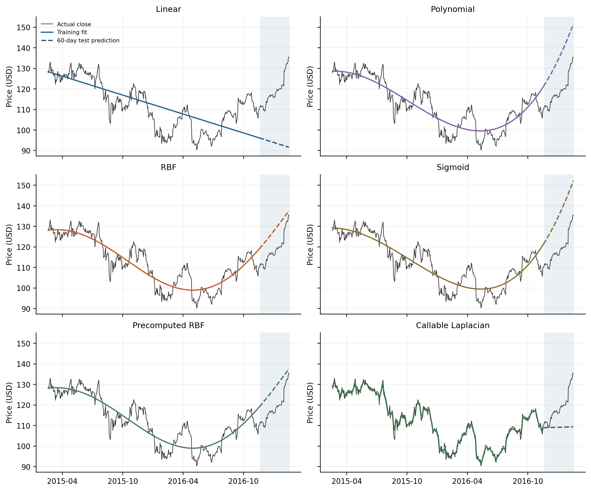
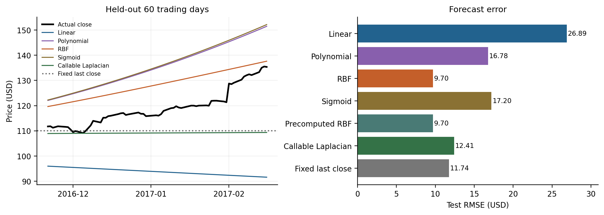

# A5 — Support Vector Regression for Stock Prices

Compare six SVR configurations on historical Apple closing prices, with chronological validation, a held-out forecast interval, and measured fitting and prediction times.

This is a standalone reconstruction of the assignment's `predict_prices` function. The original classroom function and dataset were not supplied; this implementation uses a public Apple price snapshot and documents its experimental choices.

## Results at a glance

| Configuration | CV RMSE ($) | Test RMSE ($) | Median fit (ms) | Predict 60 dates (ms) |
|---|---:|---:|---:|---:|
| Linear | 13.442 | 26.891 | 3.229 | 0.210 |
| Polynomial | 8.754 | 16.777 | 3.846 | 0.207 |
| RBF | 7.915 | 9.701 | 3.770 | 0.533 |
| Sigmoid | 8.148 | 17.204 | 4.100 | 0.220 |
| Precomputed RBF | 7.915 | 9.701 | 3.650 | 0.319 |
| Callable Laplacian | 5.683 | 12.410 | 2.885 | 0.220 |

The fixed-last-close baseline has test RMSE **$11.744**. RBF has the lowest error on the final test interval, while Laplacian has the lowest validation error and fastest median fit on the recorded machine. A rule that selected the kernel using validation alone would select Laplacian, which does not beat the baseline on this test interval. Linear and polynomial prediction timings have overlapping interquartile ranges.

Precomputed RBF is an alternative implementation of the same RBF kernel, rather than a sixth distinct kernel function. Its predictions match the built-in RBF implementation to about 1.6e-12 dollars on the saved run.





## Data and evaluation

- Source: [Plotly's Apple finance dataset](https://github.com/plotly/datasets/blob/master/finance-charts-apple.csv). The CSV is bundled, so no data download is needed when rerunning.
- Observations: 506 trading days, February 17, 2015–February 16, 2017.
- Input: calendar-date ordinal. Target: historical unadjusted `AAPL.Close` in USD.
- Training: first 446 observations, ending November 18, 2016.
- Test: last 60 observations, November 21, 2016–February 16, 2017.
- Validation: three expanding chronological folds inside the training interval, each with 60 validation observations.
- Scaling: input and target scalers are fitted only on each fold's training data, and only on the full training interval for the final fit.
- Forecast protocol: all 60 test dates are predicted from a single fitted model, without updating it using test prices.

The five distinct kernels are linear, polynomial, RBF, sigmoid, and callable Laplacian. Precomputed RBF also demonstrates scikit-learn's matrix-based interface. Across the five searches, 168 parameter settings were considered; 21 were excluded because at least one fold did not converge. All selected final fits converged. The precomputed implementation reuses the selected RBF parameters.

Timing includes preprocessing and kernel construction. The saved benchmark uses one numerical thread, a warm-up, and 41 randomized rounds. Each prediction timing averages 20 calls on the 60-date batch. Imports, data loading, hyperparameter search, and plotting are excluded. Timings depend on hardware and software.

## Run locally

Tested with Python 3.12.14. From this folder, use Python 3.12 to create an environment (`python3` below must refer to that installation):

```bash
python3 -m venv .venv
source .venv/bin/activate
python -m pip install -r requirements.txt
python verify_results.py
python assignment5.py --out results_reproduced
```

On Windows, activate the environment with `.venv\Scripts\activate` instead.

`verify_results.py` checks the bundled `results/`: source checksum, chronological split, training-only scaling, refitted predictions, metrics, convergence, and RBF equivalence. The training command writes a separate `results_reproduced/` folder. Use `--out results` only when you intend to replace the reference results.

## Use the prediction function

Run this example from this folder after installing dependencies:

```python
import json
from pathlib import Path
from assignment5 import read_data, predict_prices

dates, prices = read_data(Path('data/finance-charts-apple.csv'))
saved = json.loads(Path('results/metrics.json').read_text())
cut = saved['n_train']
params = {key: value['selected_params'] for key, value in saved['models'].items()}
fits = predict_prices(dates[:cut], prices[:cut], dates[cut:], params=params)
print(fits['rbf']['predictions'])
```

`predict_prices(dates, prices, x=None, params=None)` returns a dictionary with each fitted estimator and its predictions. Dates can be ISO strings or numeric time coordinates. With `x=None`, it returns fitted values on the training dates. The saved tuned parameters are passed explicitly above; the function's convenience defaults are not the report's tuned configuration.

## Files

| File | Purpose |
|---|---|
| [assignment5.py](assignment5.py) | Training, tuning, benchmarking, prediction function, and plots |
| [verify_results.py](verify_results.py) | Verification of the provided results |
| [requirements.txt](requirements.txt) | Pinned dependencies |
| [data/finance-charts-apple.csv](data/finance-charts-apple.csv) | Original public data snapshot |
| [data/source.json](data/source.json) | Source URL, retrieval timestamp, and checksum |
| [results/metrics.json](results/metrics.json) | Selected parameters, accuracy, and timing measurements |
| [results/cross_validation.json](results/cross_validation.json) | Search results and rejected settings |
| [results/predictions.csv](results/predictions.csv) | Actual values and all six models' predictions |
| [results/figures/](results/figures/) | PNG and PDF charts |
| [Assignment5_Completed.docx](Assignment5_Completed.docx) | Full analysis report |

## Interpretation and limits

Date-only SVR is a curve-fitting experiment on one historical stock series. All final test R² values are negative relative to the test-set mean; that mean is not an available forecast at the prediction origin. Strong in-sample fit therefore does not establish reliable future forecasting. The selected sigmoid Gram matrix is indefinite. Precomputed kernels require a dense training matrix and scale quadratically in memory. Exact timings and small numerical differences may change across environments.

## References

- [scikit-learn SVR API](https://scikit-learn.org/1.7/modules/generated/sklearn.svm.SVR.html)
- [scikit-learn SVM guide](https://scikit-learn.org/1.7/modules/svm.html)
- [Laplacian kernel API](https://scikit-learn.org/1.7/modules/generated/sklearn.metrics.pairwise.laplacian_kernel.html)
- [LIBSVM FAQ](https://www.csie.ntu.edu.tw/~cjlin/libsvm/faq.html)
